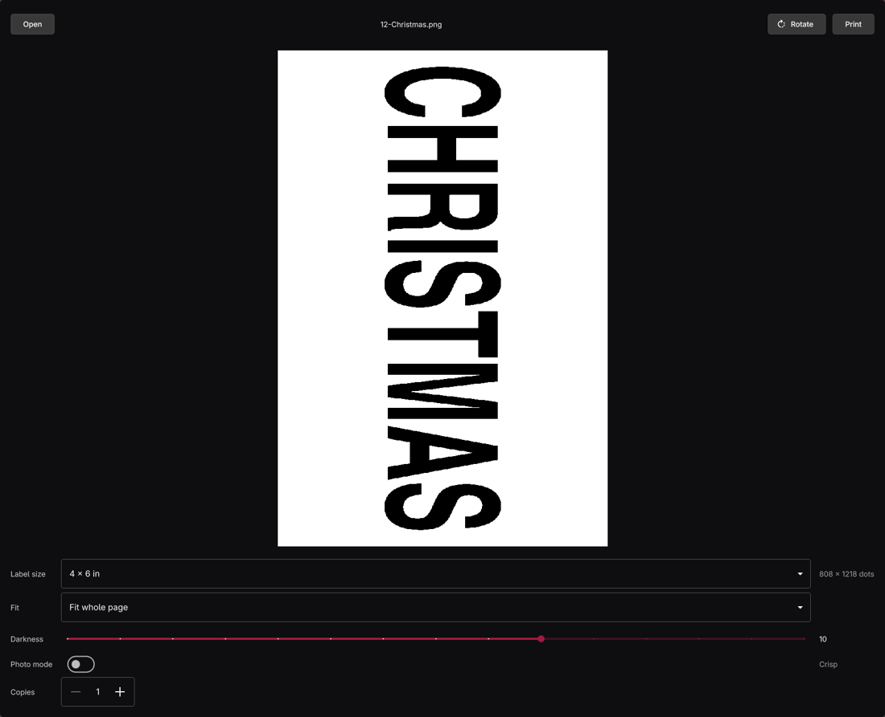

# Label Maker



Print a PDF or a picture on an Omezizy D450 label printer. Open a file, check the black and white preview, then print.

The preview is the exact 1-bit image that will be sent, at 203 dots per inch. A 4 × 6 inch label is 812 × 1218 dots, and the width is rounded down to a multiple of 8 (808) so the TSPL bitmap rows pack cleanly. Shipping labels are cropped out of a letter or A4 page and thresholded with no dithering so barcodes stay sharp. Every fit turns the artwork when that uses the label better, unless Turn is set to upright or sideways. A blank preview says there is nothing dark to print. Photo mode dithers instead.

Printing from the button is not wired up yet. The print job can still be written to a file.

## Shortcuts

| Key | Action |
| --- | --- |
| O | Open a file |
| Space | Print the label |
| ? | Show shortcuts |
| Ctrl+Z | Undo |
| Ctrl+Shift+Z | Redo |
| Q | Quit |

## Render from the command line

```sh
label-maker --render label.pdf --size 4x6 --out preview.png --tspl job.bin
label-maker --render photo.png --size 50x30mm --fit page --photo --out preview.png
```

`--fit` is `shipping` (the default), `page`, or `fill`. `--turn` is `auto` (the default), `upright`, or `sideways`. `--page` starts at 1. `--darkness` is 1–15 (default 10) and `--copies` is written into the TSPL job. Add `--json` for a one-line summary. Nothing is sent to the printer.

`label-maker` and `label-maker open file.pdf` open the window.
